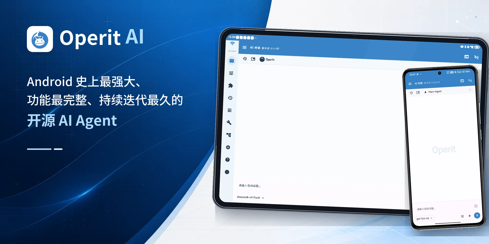
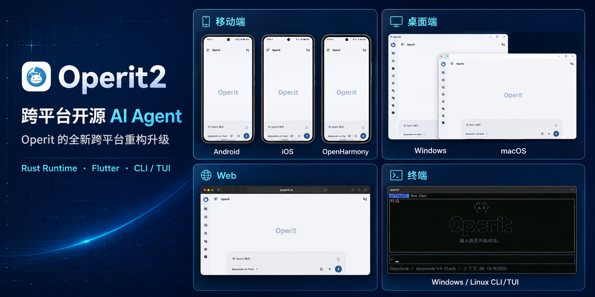
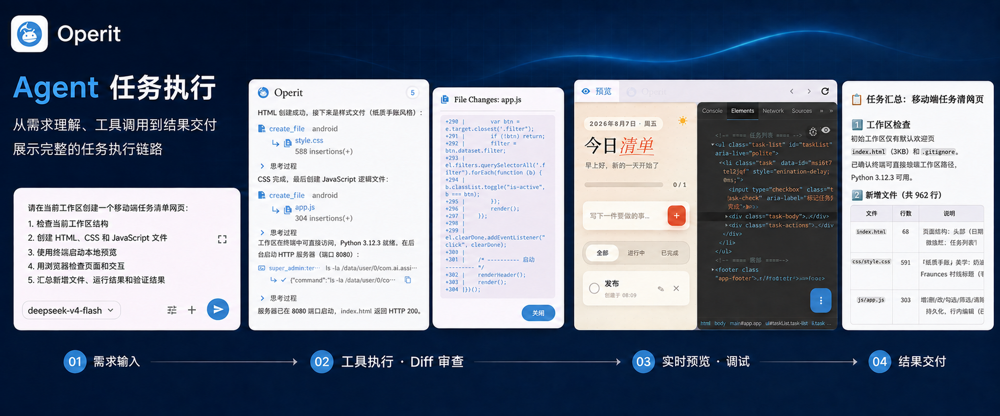
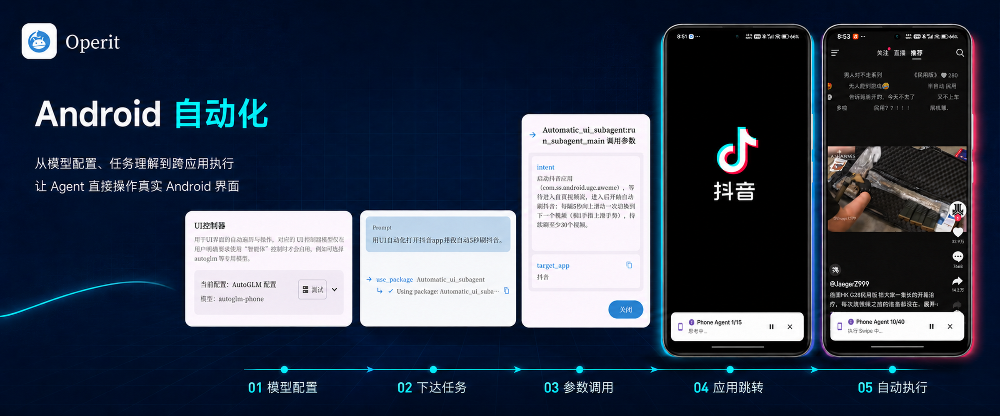
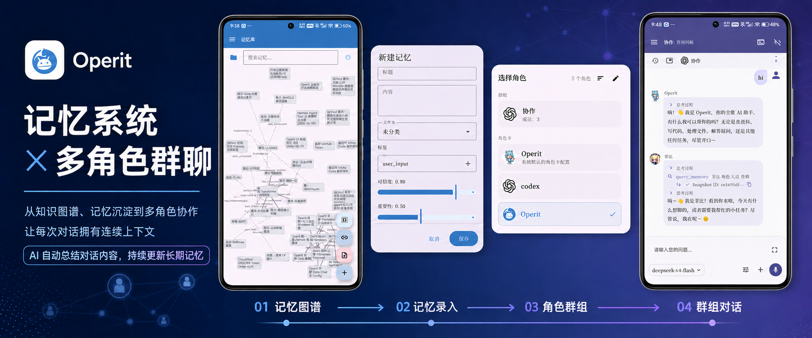
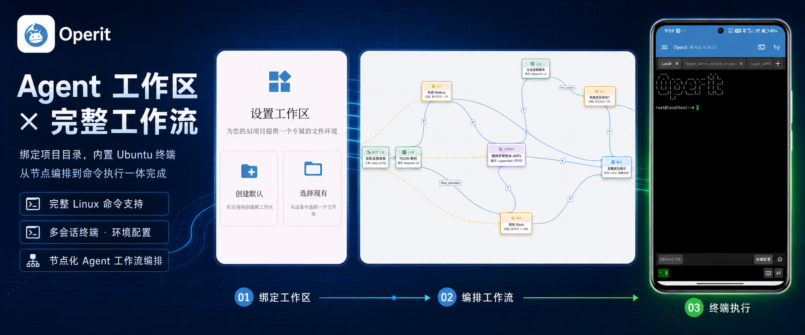
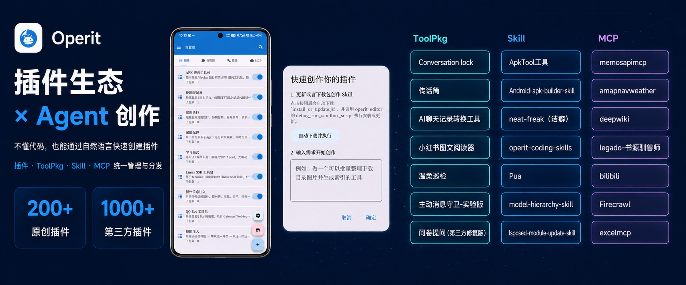

<h1 align="center">
   Operit AI
</h1>

  中文 | <a href="README.md">English</a>
   
  
  
  
  
   
  
  

  
  

  

## 🚀 Operit 2: The Cross-Platform Successor to Operit

This repository is the Android version of Operit. Operit 2 is an independent second-generation implementation built around a shared Rust runtime, a Flutter client, and the `operit2` CLI/TUI. It currently includes implementations or build paths for Android, iOS, Windows, macOS, Linux, and Web, and OpenHarmony support is being advanced. To follow the cross-platform version, visit [Operit 2](https://github.com/AAswordman/Operit2).

## Project Overview

**Operit AI** is an open-source AI Agent platform running on Android. It connects to cloud or local models and links models to the Android system, terminal, browser, files, and project workspaces, completing real tasks such as information retrieval, file processing, code development, and device automation through tool calls, workflows, and extension capabilities such as ToolPkg, MCP, and Skills.

## Core Features

- **Task-oriented Agent workspace**: supports attachments, workspace context, tool execution progress, file changes, and multi-turn task management
- **Freely chosen models and services**: connects to mainstream cloud models, custom compatible endpoints, and key pools, and can also use MNN models or run GGUF models via llama.cpp
- **Deep integration with Android and the web environment**: calls system capabilities with authorization, operates app interfaces, or reads and operates web pages through the built-in browser
- **Mobile development and terminal environment**: manages projects, edits code, and previews web pages on a phone, and uses a Ubuntu 24.04 userspace, SSH, and SFTP
- **Long-term memory and character system**: manages graph-based memory, conversation history, character cards, and multi-character conversations, and binds independent capabilities to different characters
- **Composable extensions and automation**: combines tools through a unified marketplace, workflows, and system integrations to build repeatable task flows

## Feature Showcase

## Main Features

<b>AI Chat and Models</b>

- Chats support images, audio, video, documents, workspace files, and other context
- Supports message branching, history grouping and migration, automatic summarization, context limits, and parallel conversations
- Supports OpenAI Chat/Responses, Anthropic, Gemini, and various compatible services, and model providers can be extended via ToolPkg
- Supports multiple model configurations, parameter settings, key pools, and connection tests
- Different models can be assigned to chat, memory, summarization, UI control, and other tasks
- Built-in MNN local inference, with support for running GGUF models via llama.cpp
- Can connect to local model services such as Ollama and LM Studio

<b>Tools, Device, and Browser Automation</b>

- Built-in file, network, search, media, system, software management, and development tools
- Provides three tool permission levels — auto-allow, ask each time, and deny — with ask mode as the default
- UI automation supports Accessibility, ADB-level debugging permissions provided by Shizuku, and Root channels
- PhoneAgent/AutoGLM can perform operations combined with on-screen vision; capabilities such as virtual displays require the corresponding permissions and device support
- The built-in browser provides multiple tabs, history, bookmarks, downloads, permissions, multi-window, and user scripts
- The browser Agent can read page structure and perform clicks, input, scrolling, key presses, screenshots, and other operations
- Supports OCR, image understanding, camera, FFmpeg, web access, and file transfer

<b>Project Workspaces and Terminal</b>

- Supports project templates for Web, Android, Flutter, Node.js, TypeScript, Python, Java, Go, and more
- Provides file tree, code editing, syntax highlighting, live preview, change tracking, backup, and export
- Chats can be bound to a workspace so the AI reads project rules, references files, and modifies code
- Workspaces support in-app directories, SAF, SFTP, and SSH file systems
- Built-in Ubuntu 24.04 ARM64 userspace, running via PRoot by default, and via chroot when the corresponding conditions are met
- The terminal supports multiple sessions, Python, Node.js, vim, SSH, tmux, custom keys, and software sources
- Provides development tools such as Logcat, SQLite, Git, APKTool, and HTML packaging

<b>Memory, Characters, and Conversation Management</b>

- Supports multiple memory spaces, document import and chunking, node relationship editing, and hybrid search
- Can extract information from conversations and attachments, and retrieve long-term memory by time, semantics, and relationships
- Supports character card import, export, backup, and QR code sharing, compatible with formats such as Tavern JSON/PNG
- Each character can be bound to an independent model, memory space, tool package, Skill, and MCP
- Supports multi-character group chats, @ interactions, independent conversation histories, and collaboration between characters
- Supports chat history import and export, locking, branching, batch migration, backup, and restore

<b>Extension Marketplace and Workflows</b>

- The unified marketplace supports searching, installing, and managing scripts, ToolPkg, Skills, and MCP
- There are also prompt and tag marketplaces, as well as management and publishing flows for projects and Artifacts
- ToolPkg can provide tools, interfaces, model providers, Hooks, and runtime capabilities
- MCP supports local and remote services, as well as launch methods such as uvx and npx
- Visual workflows include trigger, execution, condition, logic, data extraction, and other nodes
- Workflows support manual, scheduled, Tasker, Intent, voice, and app-launch triggers
- Provides workflow execution logs, statistics, cancellation, and batch management

<b>Voice, Avatars, and Interface</b>

- STT supports local Chinese/English recognition as well as cloud interfaces such as OpenAI and Deepgram
- TTS supports the Android system, local ONNX VITS, custom HTTP, and various cloud services
- Supports continuous voice conversations, background wake-up, custom wake templates, automatic read-aloud, and music playback queues
- Operit can be invoked via floating windows, bubbles, desktop widgets, and the Android default assistant entry point
- Virtual avatars support formats such as DragonBones, WebP, MP4, MMD, glTF/GLB, and FBX
- Supports customization of themes, fonts, chat bubbles, backgrounds, toolbars, Markdown rendering, and layouts
- The interface supports Chinese, English, Korean, Spanish, Malay, Indonesian, Brazilian Portuguese, and Romanian, and can follow the system or be switched manually
- Optional LAN Web Chat and HTTP API are disabled by default; when enabled, a Bearer Token must be configured and LAN exposure risks assessed

## Quick Start

| Item | Description |
|------|------|
| **System requirements** | Android 8.0 (API 26) or higher, ARM64 (`arm64-v8a`) devices only |
| **Resource requirements** | Memory and storage usage depends on the terminal environment, installed tool packages, and local models; reserve space as specified in the model instructions before downloading models |
| **Download and install** | Download the latest APK from the [Releases page](https://github.com/AAswordman/Operit/releases) |
| **User guide** | Visit the [Operit official website](https://operit.app/) for tutorials and examples |

> **Security tip:** Download installation packages only from the official [Releases page](https://github.com/AAswordman/Operit/releases) or the [Operit official website](https://operit.app/). Installation packages from unknown sources may have been modified, creating data and device security risks.

Installation flow: Download APK → Install and launch → Follow the guide to configure models and permissions → Start using

> **Data and network boundaries:** Chats, characters, memory, and model configurations are stored locally by the app; when using cloud models, requests are sent from the device to the provider you configured — Operit does not host chat inference. Marketplace, MCP, Skill, voice, drawing, and other features may connect to third-party services; Web Chat/HTTP API are disabled by default, and before enabling them, confirm network exposure and Bearer Token settings. Android Intent/broadcast integrations should also only be entrusted to trusted apps.

## Development History

- **April to August 2025 · From AI chat to tool execution**: gradually added tool calls, MCP, voice, floating windows, web development, and character cards
- **September to December 2025 · Deeper device and development environments**: completed the Ubuntu terminal, memory system, MNN, SSH workspaces, GUI automation, and Skill ecosystem
- **2026 to present · Becoming a mobile Agent platform**: expanded workflows, GGUF local inference, browser Agent, character group chats, Web Chat, ToolPkg, and the unified marketplace

<b>View major version update summaries</b>

- **v1.12.0 · 2026-07-01**: Unified marketplace and Artifact flow, enhanced project workspaces and ToolPkg runtime, expanded multilingual, voice, and media capabilities, and improved crash recovery
- **v1.11.0 · 2026-05-16**: Added Web Chat, Artifact marketplace, ToolPkg AI Provider and Hooks, and enhanced memory, context, and browser automation
- **v1.10.1 · 2026-04-17**: Upgraded the built-in browser and web automation, added FBX avatars, liquid glass theme, and a local HTTP chat entry point
- **v1.10.0 · 2026-03-18**: Added character group chats, AI self-configuration, Ollama/NVIDIA/OpenAI Responses modes, and more development tools
- **v1.9.1 · 2026-02-20**: Focused fixes for terminal, strict tool calls, remote MCP, memory library, and workflow issues
- **v1.9.0 · 2026-02-17**: Added mobile web auto-operation, Windows terminal control, SQLite viewer, and Android workspace templates
- **v1.8.1 · 2026-02-03**: Added llama.cpp GGUF local inference, and enhanced interface, backup, Skill, and workspace capabilities
- **v1.8.0 · 2026-01-13**: Launched workflows, voice wake triggers, parallel conversations, and automatic backup
- **v1.7.1 · 2025-12-31**: Added Root virtual display, Skill protocol and marketplace, circle-to-screen-recognition, and conversation locking
- **v1.7.0 · 2025-12-19**: Launched AutoGLM GUI automation and virtual display
- **v1.6.4 · 2025-12-12**: Integrated AutoGLM, optimized automation status display, tool package environment variables, and debug logs
- **v1.6.3 · 2025-12-07**: Supported native Tool Call, multiple model configurations, SSH file systems, and workspace project templates
- **v1.6.2 · 2025-11-22**: Enhanced conversation branching and migration, context binding, and academic search
- **v1.6.1 · 2025-11-16**: Refactored UI rendering, added visual understanding, SSH terminal, automatic summarization, and deep search
- **v1.6.0 · 2025-10-21**: Added MNN local models, smart memory library, Tasker integration, and desktop pets
- **v1.5.2 · 2025-10-05**: Enhanced MCP, workspace `.gitignore` support, camera, HTML rendering, and regex filtering
- **v1.5.1 · 2025-09-25**: Added MCP marketplace, key pools, workspace rollback on conversation resend, and manual memory library refresh
- **v1.5.0 · 2025-09-20**: Integrated Ubuntu 24.04 terminal and deep search mode
- **v1.4.0 · 2025-09-01**: Added multi-tool parallelism, character card system, and PNG character card import
- **v1.3.0 · 2025-08-04**: Added web development, theme selector, and Anthropic Claude
- **v1.2.x · 2025-07**: Added voice conversations, knowledge base, and DragonBones animation
- **v1.1.x · 2025-05 to 06**: Added MCP, OCR, floating windows, and Gemini support
- **v1.0.0 · 2025-04-11**: Released basic AI chat, tool calls, and Shizuku/Root integration

For the full update history, see the [Releases page](https://github.com/AAswordman/Operit/releases).

## Open Collaboration

Contributions to Operit's scripts, extensions, documentation, and core features are welcome.

- [Contribution guide](docs/doc-src/dev-core/CONTRIBUTING.en.md)
- [Build guide](docs/doc-src/dev-core/BUILDING.en.md)
- [Script development guide](docs/SCRIPT_DEV_GUIDE.en.md)
- [ToolPkg format guide](docs/TOOLPKG_FORMAT_GUIDE.en.md)
- Building the project requires three external dependency archives — `subpack.zip`, `jniLibs.zip`, and `libs.zip` — and initializing the `terminal` submodule; the default local STT model is automatically fetched and verified as specified in `app/config/stt-model-assets.properties`
- Community discussion: [QQ group](https://qm.qq.com/q/Sa4fKEH7sO) | [Discord](https://discord.gg/YnV9MWurRF)

### Contributors

## Support Development

If Operit has been helpful to you, you can voluntarily support the project's continued development and basic operations:

- Support from outside China: [Patreon](https://www.patreon.com/c/aaswordsman)
- Support from within China: [爱发电](https://afdian.com/a/aaswordsman)
- Sponsorship is entirely voluntary and is not tied to any feature, quota, update, Q&A, or other benefit
- Not sponsoring does not affect normal use, receiving updates, or accessing the open-source code

## License

The main body of code in this repository is licensed under [GNU LGPL v3 (LGPL-3.0-only)](https://spdx.org/licenses/LGPL-3.0-only.html). Tools, examples, templates, and third-party dependencies in the repository may be under other licenses; the specific terms are governed by [LICENSE](LICENSE), the license files in the corresponding directories, and package metadata.

## Star History

<a href="https://www.star-history.com/?repos=AAswordman%2FOperit&type=date&legend=top-left">
 <picture>
   <source media="(prefers-color-scheme: dark)" srcset="https://api.star-history.com/chart?repos=AAswordman/Operit&type=date&theme=dark&legend=top-left&sealed_token=CtZ-YNyNp2_W0AUVXHyAzBNeMlpGVkDx0RjuJPYdalj2Kvy7HkPBhb-uzKQ8t8jbMDGjRvnjHo7Fi-FtGIv-NaS0gqafGHDjgoGufAgx8yXt3gi8f4vV3aP8KskKramok4_vcKfo8Ii4AohtLRdX13mCJz0ABDqwtmec2SoK0j1kLuPyLz6oH3k4lhY4" />
   <source media="(prefers-color-scheme: light)" srcset="https://api.star-history.com/chart?repos=AAswordman/Operit&type=date&legend=top-left&sealed_token=CtZ-YNyNp2_W0AUVXHyAzBNeMlpGVkDx0RjuJPYdalj2Kvy7HkPBhb-uzKQ8t8jbMDGjRvnjHo7Fi-FtGIv-NaS0gqafGHDjgoGufAgx8yXt3gi8f4vV3aP8KskKramok4_vcKfo8Ii4AohtLRdX13mCJz0ABDqwtmec2SoK0j1kLuPyLz6oH3k4lhY4" />
   
 </picture>
</a>
---

  Made with ❤️ by the Operit Team

