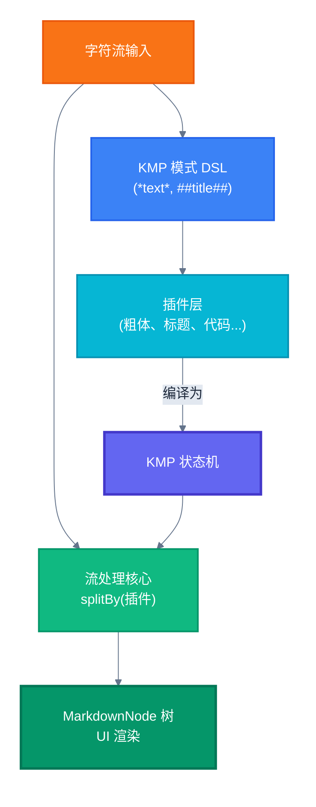

# High-Performance Streaming Markdown Rendering Engine: Architecture and Advantages

This document provides an in-depth analysis of the high-performance, KMP-based streaming Markdown rendering engine used in this project. The engine is designed specifically for scenarios that require real-time, incremental rendering of Markdown content, such as displaying streaming responses from a large language model (LLM). It delivers an elegant "typewriter" effect while maintaining excellent performance and extremely low memory usage.

## Core Advantages

The rendering engine's design combines several advanced ideas, giving it significant advantages when handling dynamic Markdown data streams.

### 1. True Streaming: Low Memory, High Real-Time Performance

Unlike traditional renderers that load an entire document at once before parsing it, this engine is designed from the ground up to work on a `Stream<Char>` (character stream).

-   **Character-by-character processing**: Data flows in as individual characters, and the parser processes it in real time, without waiting for the entire document to finish loading.
-   **Extremely low memory usage**: It is well suited to large Markdown files or unbounded network data streams, because it does not need to cache the entire content in memory.
-   **Real-time rendering**: Parsing and rendering proceed in sync, so content can be shown on screen as soon as it arrives, giving users immediate feedback.

### 2. Efficient KMP Algorithm: Pattern Matching in Linear Time

The core of the engine is `StreamKmpGraph`, a pattern-matching state machine based on the [Knuth-Morris-Pratt (KMP)](https://en.wikipedia.org/wiki/Knuth–Morris–Pratt_algorithm) algorithm.

-   **No backtracking**: Unlike traditional regular expressions, which require extensive backtracking on match failure, the KMP algorithm uses a precomputed failure function for efficient state transitions, keeping parsing performance stable.
-   **Linear time complexity**: For input of any length, parsing time complexity is O(n), ensuring high speed even when processing long text.
-   **Powerful DSL**: With the `kmpPattern` domain-specific language, complex and efficient matching patterns can be built declaratively, with excellent code readability and maintainability.

### 3. Plugin-Based Architecture: Highly Extensible Syntax Rules

The entire parsing system is built around `StreamPlugin`. Each Markdown syntax (such as headings, code blocks, bold, and so on) is implemented as an independent plugin.

-   **Separation of concerns**: Each plugin is responsible only for recognizing and handling one specific syntax, keeping the logic clear.
-   **High extensibility**: To support a new Markdown syntax (for example, a custom diagram syntax), you only need to implement a new `StreamPlugin` interface and add it to the plugin list, without modifying the existing core parsing logic.
-   **Composability**: Plugins can be flexibly combined into different lists (for example, a block-level plugin list and an inline plugin list) to suit different parsing needs.

### 4. Two-Stage Nested Parsing: Precise Handling of Complex Markdown Structures

To correctly handle nested Markdown syntax (such as bold text inside a list), the engine uses a two-stage parsing strategy:

1.  **Block-level parsing**: First, block-level plugins such as headings, lists, and code blocks are used to split the entire character stream into multiple independent blocks.
2.  **Inline parsing**: Then, the content stream of each block is split and parsed a second time using inline plugins such as bold, italic, and links.

This divide-and-conquer strategy ensures that even complex nested formatting is recognized and rendered accurately.

### 5. Smart UI Batch Updates: Ensuring a Smooth Incremental Rendering Experience

At the UI level, `StreamMarkdownRenderer` uses several optimizations to ensure a smooth "typewriter" effect, even when the data stream is fast.

-   **Batch updates**: Through `BatchNodeUpdater`, the renderer does not trigger a UI redraw immediately every time a new character arrives; instead, it merges multiple updates within a short period into a single batch operation, greatly reducing recomposition overhead.
-   **State-driven UI**: Using Jetpack Compose's `SnapshotStateList` and `key`, only UI nodes that have changed are updated, enabling efficient incremental rendering.
-   **Elegant animations**: Newly appearing nodes are shown with a smooth fade-in animation, improving the visual experience.

## Architecture Diagram

The diagram below shows the complete data-processing flow from raw character-stream input to final UI rendering.



## Workflow Breakdown

### 1. Pattern Definition Stage (Compile Time)
Each Markdown syntax defines its matching rules through the `kmpPattern` DSL:
```kotlin
// 粗体模式：*content*
kmpPattern {
    char('*')
    group(1) { greedyStar { noneOf('*') } }
    char('*')
}
```
These patterns are compiled into efficient `StreamKmpGraph` state machines, each containing:
- **KMP state nodes**: fast state transitions based on the failure function
- **Two-stage matching**: fast KMP positioning + regular-expression capture-group extraction

### 2. Plugin Initialization
Each `StreamPlugin` (such as `BoldPlugin` and `HeaderPlugin`) wraps a `StreamKmpGraph`, and plugins are sorted by priority (long patterns first, short patterns later).

### 3. Streaming Parse Core — the splitBy Operation

**Stage 1: Block-Level Parsing**
```kotlin
charStream.splitBy(blockPlugins).collect { blockGroup ->
    // 每个字符都被所有块级插件并行处理
    // KMP 算法确保 O(n) 时间复杂度，无回溯
}
```

**Stage 2: Inline Parsing** 
```kotlin
blockGroup.stream.splitBy(inlinePlugins).collect { inlineGroup ->
    // 对每个块的内容再次进行 KMP 模式匹配
    // 实现嵌套语法的正确解析
}
```

### 4. How the KMP Algorithm Works

For each input character `c`:
1. **State transition**: Try to move from the current state to the next state via character `c`
2. **Failure handling**: If the transition fails, use the KMP failure function to jump to a suitable fallback state
3. **Match detection**: On reaching a final state, trigger second-stage regex matching to extract capture groups
4. **Result returned**: Return a `Match` (with capture groups), `InProgress`, or `NoMatch`

The key advantages of this design:
- **Zero backtracking**: The KMP algorithm guarantees linear time complexity, no matter how complex the input
- **Real-time processing**: Characters are processed as they flow in, without buffering the entire document
- **Precise capture**: Combined with regular-expression capture-group functionality, structured data is extracted

### 5. Data Output
The parse results are ultimately built into a `MarkdownNode` tree structure, supporting real-time streaming UI rendering and a smooth "typewriter" effect.
